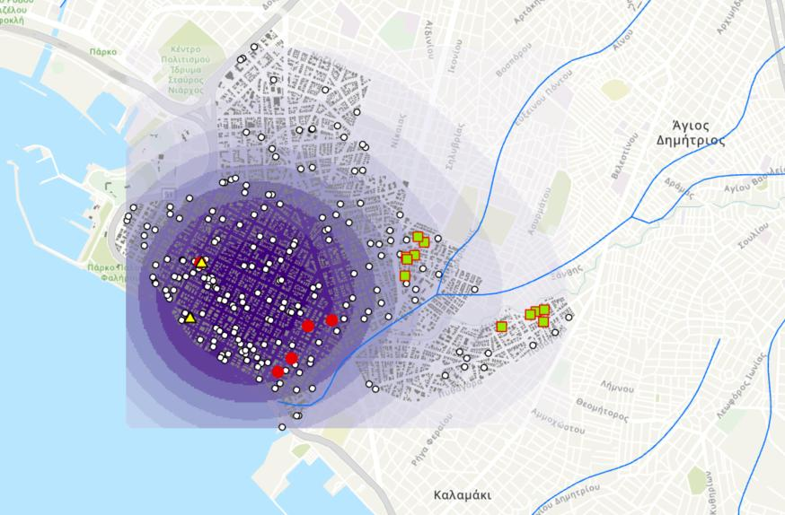
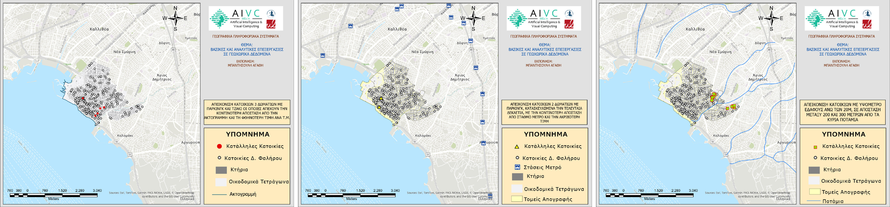
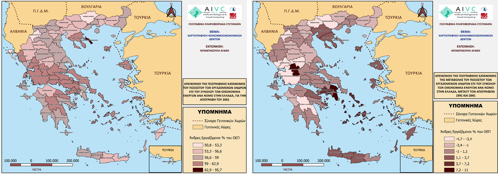
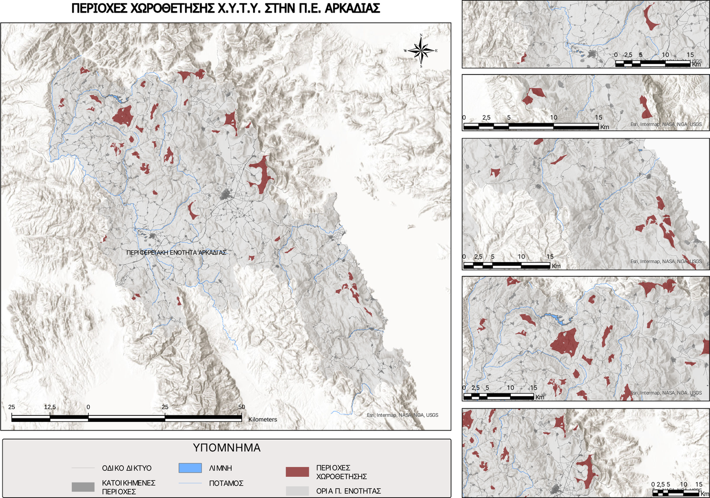
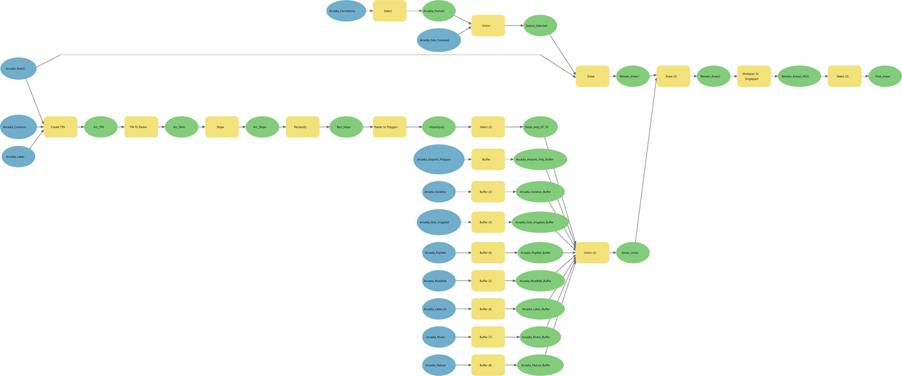
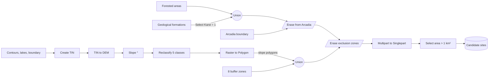

# Applied GIS, Spatial Analysis & Site Suitability Portfolio

Coursework from the MSc in Artificial Intelligence & Visual Computing (course *Geographic Information Systems*, University of West Attica, 2024–25): housing queries and kernel density analysis, thematic cartography of census data, and an exclusion-based landfill site-selection model. The exercises are individual; the data, criteria and buffer widths come from the course briefs.

---

## 📌 Projects & Modules Overview

### 1. Spatial Queries & Kernel Density Analysis, Palaio Faliro (ArcGIS Pro)
* **Objective:** Answer housing questions for the municipality of Palaio Faliro (Athens) from 220 apartment listings with attributes such as area, floor, year of construction and price, together with building blocks, rivers, DEM and metro stations.
* **Attribute & spatial queries:** Distances of the listings to the coastline and to metro stations were combined with attribute filters to answer three questions: (1) 3-room homes with parking and fireplace, **closest** to the coastline, with the lowest price per m²; (2) 2-room homes with parking, built in the last decade, closest to a metro station, with the highest price; (3) homes above 20 m elevation located 200–300 m from the main rivers.
* **Kernel Density Estimation (KDE):** Applied to the high-price-per-m² listings to look for spatial concentrations. The relation of these concentrations to the coast, the streams and the metro network was **examined visually**; no statistical test or regression was carried out, so the reading is indicative (220 points, listings rather than all dwellings).
* 📄 **[Technical Note (PDF - Greek)](./Exercise_1_1_Spatial_Density_KDE.pdf)**

  
   <em>Kernel density of high-price apartments, Palaio Faliro (Athens)</em>

  
   <em>Results of the three housing queries in Palaio Faliro (map layouts in ArcGIS Pro)</em>

---

### 2. Socioeconomic Indicators & Thematic Cartography (QGIS)
* **Objective:** Map economic-activity indicators by prefecture (nomos) for Greece from the 1991 and 2001 censuses: the share of employed men in the economically active population in 2001 (map 1) and its change between 1991 and 2001 (map 2).
* **Data pipeline:**
  * Census tables cleaned and restructured (prefecture rows only, Latin field names, ratio indicators).
  * **Attribute join** of the table to the prefecture polygons through the prefecture code.
  * **Dissolve** to merge the several polygons of each prefecture (islands, multi-part geometry) into one feature, so that each prefecture has a single label.
  * Classification with **Natural Breaks (Jenks)**, using the histogram of the values (5 classes for map 1, 6 for map 2).
  * A4 print layout at 1:4,000,000 with legend, scale bar, north arrow, neighbouring countries and an inset for the Dodecanese.
* 📄 **[Technical Report (PDF - Greek)](./Exercise_1_2_Socioeconomic_Thematic_Cartography.pdf)**

  
   <em>Thematic maps by prefecture (QGIS)</em>

> **Known issue (map 2):** the change indicator in the delivered map was computed as (employed men 2001 − employed men 1991) / (total active 2001 + total active 1991) × 100, which measures the change in the **number** of employed men rather than the change in the **percentage**. The change in the percentage is
> `(EMPL_MEN_2001 / TOTAL_2001 − EMPL_MEN_1991 / TOTAL_1991) × 100` (percentage points). Recomputed from the same table, the share fell in **all 55 prefectures**, by between 3.7 and 17.4 percentage points (mean ≈ 9.2), whereas the delivered indicator ranges from −4.7 to +11 and has the opposite sign in 27 prefectures. Map 1 (share in 2001) is not affected. Map 2 should be regenerated with the corrected indicator.

---

### 3. Exclusion-Based Site Suitability Modeling for a Sanitary Landfill (ArcGIS ModelBuilder)
* **Objective:** Automated site selection for a sanitary landfill (Χ.Υ.Τ.Υ.) in the Regional Unit of Arcadia, Greece, with the criteria of the course scenario (a multi-criteria approach based on **exclusion criteria**; there is no weighting or scoring of sites).
* **Criterion 1, exclusion:** forests, and **karst formations** (limestone and dolomite, highly permeable rock where leachate could reach groundwater quickly), removed from the study area. Remaining area: ≈ 2,789 km² of the 4,419 km² of the prefecture.
* **Surface & terrain processing:** a **TIN** was built from the contours (20 m contour interval) and converted to a **DEM** (cell size ≈ 16 m, ArcGIS default); **slope** was derived and reclassified into 5 classes. The accuracy of the slope is limited by the 20 m contour interval.
* **Criterion 2, detection and exclusion:** buffer zones around airports, shoreline, irrigated land, settlements, roads, lakes, rivers and Natura 2000 sites, combined with the steep-slope polygons (Union) and erased from the area left by criterion 1. Remaining area: ≈ 171 km².
* **Criterion 3, final selection:** Multipart to Singlepart and a minimum-area filter (**1 km²** in the delivered model) → 36 candidate areas, ≈ 135 km² in total.
* 🐍 **[Python (ArcPy) version of the model](./modelbuilder/landfill_site_suitability.py)**, exported from the original ModelBuilder toolbox.
* 📄 **[Final Cartographic Deliverable (PDF)](./Exercise_2_Landfill_Suitability_Arcadia_Map.pdf)**
* 📄 **[ModelBuilder Architecture (PDF)](./Exercise_2_MCDA_ModelBuilder_Workflow.pdf)**

  
   <em>Final map: candidate landfill areas in the Regional Unit of Arcadia</em>

  
   <em>Suitability model in ArcGIS ModelBuilder</em>

#### Model workflow

| Exclusion layer | Buffer distance | Buffer side |
| :--- | ---: | :--- |
| Airports | 2,840 m | outside only |
| Shoreline | 2,760 m | right |
| Settlements | 1,880 m | outside only |
| Natura 2000 sites | 1,860 m | full |
| Lakes | 1,340 m | full |
| Rivers | 1,340 m | full |
| Roads | 850 m | full |
| Irrigated land | 460 m | full |

The widths are the student-specific values defined by the course brief, not legal distances. The shortest distances from the delivered candidate areas to each layer match these widths (for example 1,878 m to settlements, 2,839 m to the airport, 2,758 m to the shoreline).

#### Known issues and differences from the course brief

* **The steep-slope criterion removed nothing.** The steep-slope polygons are selected with `gridcode > 10`, but after reclassification the values are 1–5, so the selection is empty (the layer `Slope_poly_GT_10` has 0 features). Excluding slopes above 10° requires `gridcode >= 3`. Consequently the delivered candidate areas were **not** filtered by slope: about 68 % of their area lies in slope classes 3–5. The Python script keeps the original expression and documents the correction.
* **Minimum area:** the brief asks for areas larger than 4,000 stremmata (4 km²); the delivered model uses 1 km². Only 8 of the 36 areas exceed 4 km².
* **Roads:** the buffer was applied to all 3,305 road segments; the brief restricts it to motorway, primary, secondary and tertiary roads.
* **Wetlands:** the brief assigns the Natura wetland polygons to criterion 1 and buffers only the remaining Natura sites; here all Natura polygons, including the wetland, were buffered.
* The DEM is derived from 20 m contours and the criteria are exclusion rules only, so the result is a screening of possible areas, not a ranking of sites.

---

## 🛠️ Software & Technical Stack
* **GIS Suites:** ArcGIS Pro / ArcMap (ModelBuilder, 3D Analyst, Spatial Analyst), QGIS
* **Techniques:** Exclusion-based multi-criteria analysis, Kernel Density Estimation (KDE), terrain analysis (TIN, DEM, slope), automated geoprocessing (ModelBuilder, ArcPy), vector overlays and buffers, attribute and spatial queries, thematic cartography
