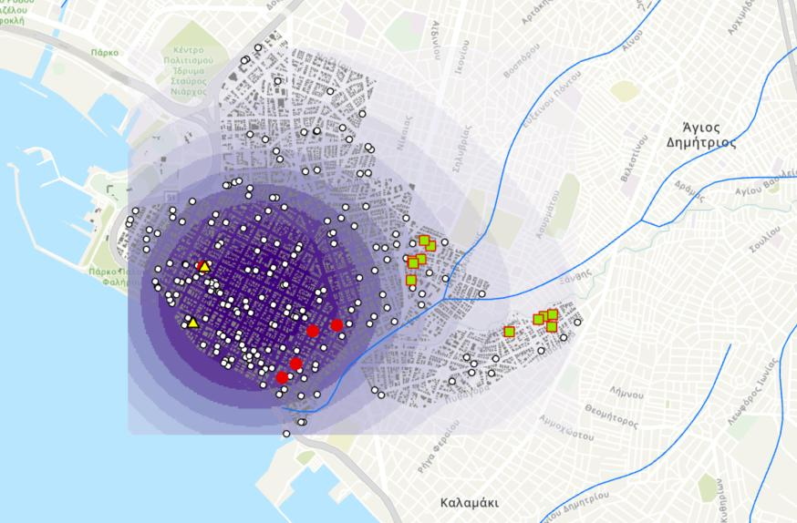
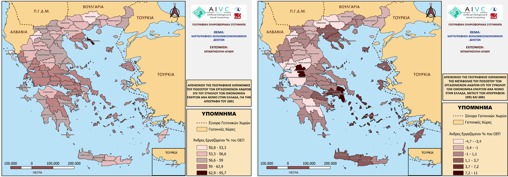
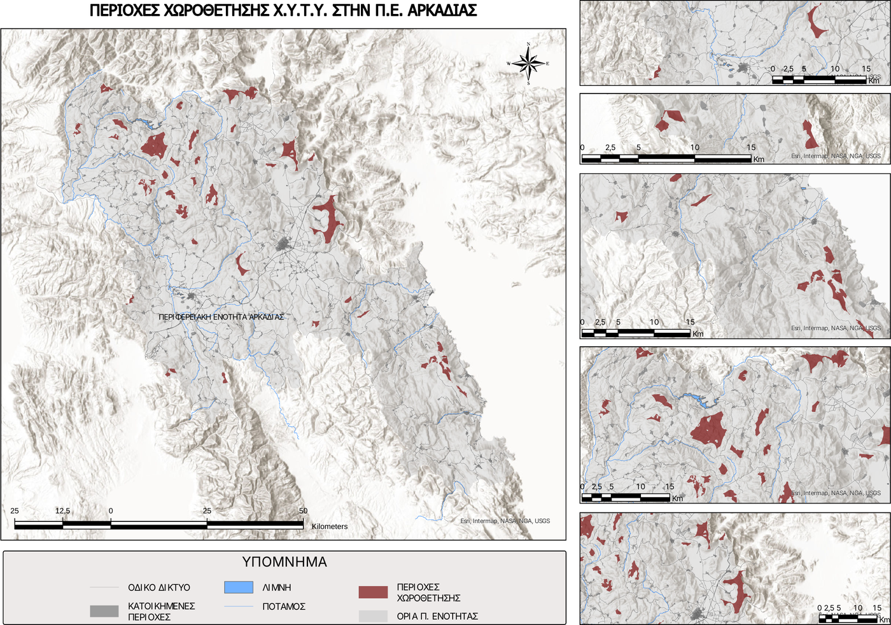
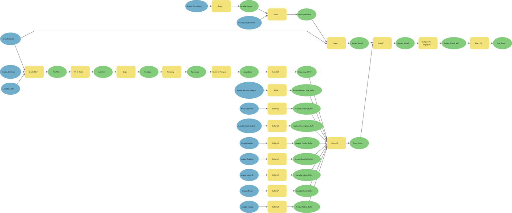

# Applied GIS, Spatial Analysis & Automated Suitability Modeling Portfolio

A comprehensive portfolio of spatial modeling, geodemographic cartography, and spatial statistics developed during postgraduate studies in GIS and Visual Computing.

---

## 📌 Projects & Modules Overview

### 1. Spatial Statistics & Urban Amenity Analysis (KDE)
* **Objective:** Spatial analysis of residential property valuations across Palaio Faliro (Athens, Greece).
* **Methodology:** Applied **Kernel Density Estimation (KDE)** to identify spatial clustering and price hot-spots.
* **Spatial Drivers:** Evaluated distance-decay impacts of coastal proximity, hydrographic barriers, and public infrastructure accessibility.
* 📄 **[Technical Note (PDF - Greek)](./Exercise_1_1_Spatial_Density_KDE.pdf)**

  
   <em>Kernel density of residential property values, Palaio Faliro (Athens)</em>

---

### 2. Geodemographic Analysis & Thematic Cartography (QGIS)
* **Objective:** National-scale mapping of economic activity and workforce shifts across Greek prefectures using census records (1991–2001).
* **Spatial Data Pipeline:** 
  * Tabular data cleaning, attribute structuring, and ratio index calculations.
  * Spatial joins and topological vector preprocessing using the **Dissolve** tool to resolve duplicate administrative boundaries.
  * Statistical classification via **Natural Breaks (Jenks)** based on distribution histograms.
  * Professional print layout production at 1:4,000,000 scale featuring thematic legends, scale bars, north arrows, and spatial insets.
* 📄 **[Technical Report (PDF - Greek)](./Exercise_1_2_Socioeconomic_Thematic_Cartography.pdf)**

  
   <em>Thematic maps of economic activity across Greek prefectures (QGIS)</em>

---

### 3. Multi-Criteria Site Suitability Modeling (ArcGIS ModelBuilder)
* **Objective:** Automated spatial site selection for a Sanitary Landfill (Χ.Υ.Τ.Υ.) across the Regional Unit of Arcadia, Greece.
* **Surface & Terrain Processing:** 
  * Interpolated Triangulated Irregular Networks (**TIN**) into high-resolution Digital Elevation Models (**DEM**).
  * Extracted slope gradients (**Slope**) and reclassified terrain suitability thresholds.
* **Spatial Multi-Criteria Decision Analysis (MCDA):**
  * Automated geoprocessing pipeline constructed in **ArcGIS ModelBuilder**.
  * Applied spatial buffer exclusions (**Multi-ring Buffers**) around urban settlements, hydrological networks, and transport axes.
  * Integrated multi-layer vector overlay operations (Erase, Union, Intersect) to isolate compliant land parcels meeting regulatory and environmental constraints.
* 📄 **[Final Cartographic Deliverable (PDF)](./Exercise_2_Landfill_Suitability_Arcadia_Map.pdf)**
* 📄 **[Automated ModelBuilder Architecture (PDF)](./Exercise_2_MCDA_ModelBuilder_Workflow.pdf)**

  
   <em>Final map: suitable landfill sites in the Regional Unit of Arcadia</em>

  
   <em>Automated suitability model in ArcGIS ModelBuilder</em>

---

## 🛠️ Software & Technical Stack
* **GIS Suites:** ArcGIS Pro / ArcMap (ModelBuilder, 3D Analyst, Spatial Analyst), QGIS
* **Techniques:** Multi-Criteria Decision Analysis (MCDA), Kernel Density Estimation (KDE), Terrain Analysis, Automated Geoprocessing, Vector Overlays
