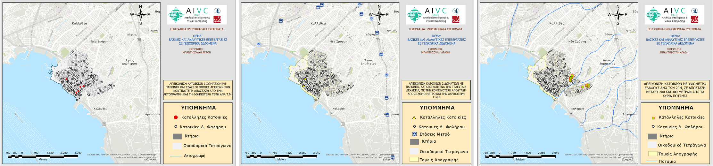
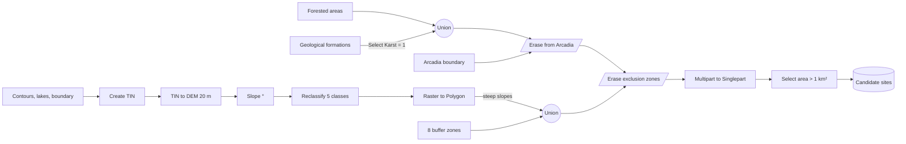

# Applied GIS, Spatial Analysis & Automated Suitability Modeling Portfolio

A comprehensive portfolio of spatial modeling, geodemographic cartography, and spatial statistics developed during postgraduate studies in GIS and Visual Computing.

---

## 📌 Projects & Modules Overview

### 1. Spatial Statistics & Urban Amenity Analysis (KDE)
* **Objective:** Spatial analysis of residential property valuations across Palaio Faliro (Athens, Greece).
* **Methodology:** Applied **Kernel Density Estimation (KDE)** to identify spatial clustering and price hot-spots.
* **Spatial Drivers:** Evaluated distance-decay impacts of coastal proximity, hydrographic barriers, and public infrastructure accessibility.
* 📄 **[Technical Note (PDF - Greek)](./Exercise_1_1_Spatial_Density_KDE.pdf)**

  
   <em>Kernel density of residential property values, Palaio Faliro (Athens)</em>

* **Attribute & Spatial Queries (ArcGIS Pro):** Combined attribute filters with distance and proximity analysis to answer three housing questions – (1) 3-bedroom homes with parking and fireplace, farthest from the coastline, with the lowest price per m²; (2) 2-bedroom homes with parking, built in the last decade, closest to a metro station, with the highest price; (3) homes above 20 m elevation located 200–300 m from the main rivers.

  
   <em>Results of the three housing queries in Palaio Faliro (map layouts in ArcGIS Pro)</em>

---

### 2. Geodemographic Analysis & Thematic Cartography (QGIS)
* **Objective:** National-scale mapping of economic activity and workforce shifts across Greek prefectures using census records (1991–2001).
* **Spatial Data Pipeline:** 
  * Tabular data cleaning, attribute structuring, and ratio index calculations.
  * Spatial joins and topological vector preprocessing using the **Dissolve** tool to resolve duplicate administrative boundaries.
  * Statistical classification via **Natural Breaks (Jenks)** based on distribution histograms.
  * Professional print layout production at 1:4,000,000 scale featuring thematic legends, scale bars, north arrows, and spatial insets.
* 📄 **[Technical Report (PDF - Greek)](./Exercise_1_2_Socioeconomic_Thematic_Cartography.pdf)**

  
   <em>Thematic maps of economic activity across Greek prefectures (QGIS)</em>

---

### 3. Multi-Criteria Site Suitability Modeling (ArcGIS ModelBuilder)
* **Objective:** Automated spatial site selection for a Sanitary Landfill (Χ.Υ.Τ.Υ.) across the Regional Unit of Arcadia, Greece.
* **Surface & Terrain Processing:** 
  * Interpolated Triangulated Irregular Networks (**TIN**) into high-resolution Digital Elevation Models (**DEM**).
  * Extracted slope gradients (**Slope**) and reclassified terrain suitability thresholds.
* **Spatial Multi-Criteria Decision Analysis (MCDA):**
  * Automated geoprocessing pipeline constructed in **ArcGIS ModelBuilder**.
  * Applied buffer exclusion zones around airports, shoreline, irrigated land, settlements, roads, lakes, rivers and Natura 2000 sites.
  * Integrated vector overlay operations (Union, Erase, Multipart to Singlepart, Select) to isolate compliant land parcels larger than 1 km².
  * 🐍 **[Python (ArcPy) version of the model](./modelbuilder/landfill_site_suitability.py)**, exported from the original ModelBuilder toolbox.
* 📄 **[Final Cartographic Deliverable (PDF)](./Exercise_2_Landfill_Suitability_Arcadia_Map.pdf)**
* 📄 **[Automated ModelBuilder Architecture (PDF)](./Exercise_2_MCDA_ModelBuilder_Workflow.pdf)**

  
   <em>Final map: suitable landfill sites in the Regional Unit of Arcadia</em>

  
   <em>Automated suitability model in ArcGIS ModelBuilder</em>

#### Model workflow

| Exclusion layer | Buffer distance | Side |
| :--- | ---: | :--- |
| Airports | 2,840 m | outside only |
| Shoreline | 2,760 m | right |
| Settlements | 1,880 m | outside only |
| Natura 2000 sites | 1,860 m | full |
| Lakes | 1,340 m | full |
| Rivers | 1,340 m | full |
| Roads | 850 m | full |
| Irrigated land | 460 m | full |

> **Note:** in the original model the steep-slope polygons are selected with `gridcode > 10`, but after reclassification the values are 1–5, so this criterion selects no polygons. Excluding slopes above 10° requires `gridcode >= 3`; the Python script keeps the original expression and documents the correction.

---

## 🛠️ Software & Technical Stack
* **GIS Suites:** ArcGIS Pro / ArcMap (ModelBuilder, 3D Analyst, Spatial Analyst), QGIS
* **Techniques:** Multi-Criteria Decision Analysis (MCDA), Kernel Density Estimation (KDE), Terrain Analysis, Automated Geoprocessing (ModelBuilder, ArcPy), Vector Overlays, Attribute & Spatial Queries
